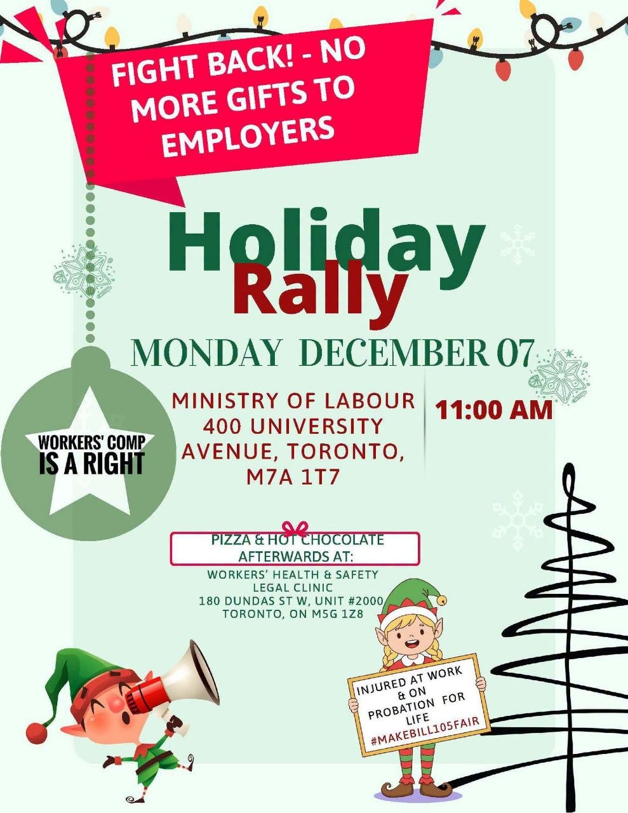

Province-wide Day of Action: Fight Back Rally at Queen's Park (111 Wellesley St W), Toronto, Monday December 7, 2026, 11:00 AM–1:00 PM. Organized by Ontario Network of Injured Workers Groups (ONIWG).

- Part of the December 7 province-wide Day of Action for injured workers.
- 11:00 AM–1:00 PM at Queen's Park, 111 Wellesley St W, Toronto.
- Organized by Ontario Network of Injured Workers Groups (ONIWG).
- Event poster attached to the event card.

